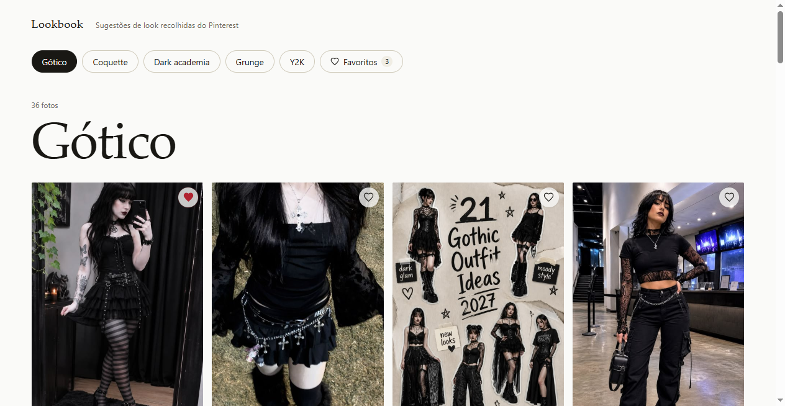

# Lookbook

App desktop que junta fotos de look do Pinterest por estética. Você escolhe um
filtro na barra e o grid se atualiza. O coração guarda o look numa pasta no seu
computador.



## Rodar

Pelo atalho **Lookbook** no Desktop, ou:

```bash
npm install
npm start
```

Se `npm start` reclamar que o Electron não foi instalado (o npm às vezes não
baixa o binário), rode:

```bash
node node_modules/electron/install.js
```

O atalho do Desktop é criado por `scripts/make-shortcut.ps1`. Ele aponta para o
Electron do projeto — não existe instalador. Se você mover a pasta, rode o
script de novo para o atalho voltar a funcionar.

## Favoritos

Clique no coração de uma foto. O arquivo é baixado na hora para:

```
C:\Users\<você>\Documents\Lookbook
```

Cada look vira uma imagem `.jpg`/`.png` e o índice fica em `favoritos.json`, na
mesma pasta. A aba **Favoritos** mostra tudo, e o botão **Abrir pasta** leva
direto para lá.

Remover um favorito manda o arquivo para `Lookbook/lixeira` em vez de apagar.
O aviso na tela tem **Desfazer** por 8 segundos.

## Mudar os filtros

Tudo em `keywords.json`:

```json
{
  "niches": [
    {
      "id": "gotico",
      "label": "Gótico",
      "queries": ["look gótico", "gothic outfit", "gothic outfit ideas"]
    }
  ]
}
```

- `id`: minúsculas, sem acento, com hífen. É o que o app usa na chamada.
- `label`: o que aparece no botão.
- `queries`: 2 ou 3 buscas. O app intercala os resultados delas.

Ponha sempre uma query em inglês. Tem muito mais acervo que em português.
Prefira `... outfit` ou `... outfit ideas`; evite `... aesthetic`, que traz
fotos de clima (castelo, cenário) em vez de roupa.
Se um filtro aparecer vazio na tela, troque a frase — o Pinterest bloqueia
algumas expressões por região (acontece com `coquette aesthetic`).

## Verificar que está tudo de pé

```bash
npm run check    # sintaxe + testes offline
npm run smoke    # abre o app, busca um nicho e testa salvar/remover favorito
npm test         # só os testes offline
npm run test:live
```

## Como funciona por dentro

```
main/lib.js        monta a requisição, lê a resposta, valida o config
main/pinterest.js  rede, cache em disco, fila para não tomar bloqueio
main/favorites.js  grava a imagem e o índice na pasta do usuário
main/protocol.js   serve as imagens salvas para a tela
main/lookbook.js   liga config + transporte
main/ipc.js        ponte para a tela
renderer/          HTML/CSS/JS puro
```

A tela pede ao processo principal, que faz a busca e devolve as fotos. A tela
nunca fala com o Pinterest: o site não permite chamada direta de dentro do app.

Os resultados ficam em cache por 6 horas em `%APPDATA%/pinterest-looks/`.
Segunda abertura do mesmo filtro é instantânea.

## Limites

Isto consome um endpoint interno do Pinterest, não a API oficial. Não tem
garantia de estabilidade e o uso automatizado contraria os termos de uso do
Pinterest. Para uso comercial, veja a API v5 ou um provedor pago de dados.